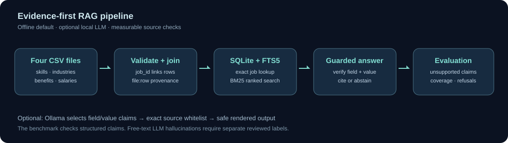

# Job Market RAG: Hallucination Detection and Guardrails

**A working RAG project built for a Forward Deployed Engineer portfolio.**

I used four job-market CSV files to build a small question-answering service. It can look up a job's skills, benefits, industry IDs and salary records. It shows the file and row behind each fact. If the data does not contain an answer, the guarded version says so.

I also built a deliberately weak baseline and tested both versions on the same questions. This shows why retrieving the wrong record and making up an answer are problems worth measuring separately.

> **What this project does not claim:** The offline baseline is not an AI language model, and the benchmark does not measure every possible LLM hallucination. The default evaluation checks structured facts against the original CSV data. A separate manual-review workflow is included for judging natural-language model outputs.

## Demo

Start the API, then open **http://127.0.0.1:8000** to use the browser demo. You can also open **http://127.0.0.1:8000/docs** for Swagger API documentation.

The demo lets you switch between:

- **Guarded:** exact job-ID lookup, source-backed facts and a clear refusal when evidence is missing.
- **Baseline:** an intentionally unsafe retrieval fallback for comparison. **Do not use in a real product.**
- **Ollama:** an optional local LLM that proposes structured claims; the app only displays claims that match the source records exactly.



## What is in the data?

| Source | Rows | What I use |
|---|---:|---|
| `benefits.csv` | 67,943 | Benefit type and inferred flag |
| `job_industries.csv` | 164,808 | Industry IDs |
| `job_skills.csv` | 213,768 | Skill abbreviations |
| `salaries.csv` | 40,785 | Salary range/median, currency, pay period |
| **Total** | **487,304** | **128,427 unique job IDs** |

These are the counts from the four included source files. An industry ID is not an industry name. A skill abbreviation is not a complete skill definition. Also, these files do **not** include company names, job titles, locations, full job descriptions or code lookup tables. The system must not invent those fields.

A missing salary row means **salary information is not available here**, not that the salary is zero. An `inferred=1` benefit is flagged as inferred, not confirmed.

See [docs/data_dictionary.md](docs/data_dictionary.md) for each column and its meaning.

## How it works

```text
CSV files
   |
   v
Schema validation + job_id join
   |
   v
SQLite jobs table + FTS5 full-text index
   |
   v
Question -> intent check -> exact job ID or ranked text lookup
   |
   v
Source-backed structured claims (optional: Ollama proposes claims)
   |
   v
Verify job ID, field and value against source records
   |
   +--> supported -> show answer with file:row citations
   |
   +--> unsupported/missing -> reject or abstain
   |
   v
Offline evaluation + optional human LLM review
```

I picked **SQLite FTS5 with BM25**, not a vector database, for the first version. Most useful fields here are IDs, codes and short labels. Exact matching matters more than semantic similarity for these fields. The code is still a retrieval-augmented answering system; the model is optional so the tests run without a GPU, paid API or network access. See [docs/architecture.md](docs/architecture.md) for the trade-offs.

## Run on Windows (PowerShell)

These commands assume you have **Python 3.11** and Git installed. Run them from the project folder, the one containing `README.md`.

**Step 1 — Create a virtual environment**

```powershell
py -3.11 -m venv .venv
```

**Step 2 — Install Python packages**

```powershell
.\.venv\Scripts\python.exe -m pip install -r requirements.txt
```

**Step 3 — Build the searchable database**

```powershell
.\.venv\Scripts\python.exe -m job_rag.ingest
```

This reads the four original files from `data/raw/` and creates `data/processed/jobs.sqlite`. It does not edit the CSV files. The SQLite file is ignored by Git because it can be rebuilt.

**Step 4 — Ask a question from the terminal**

```powershell
.\.venv\Scripts\python.exe -m job_rag.cli --question "What skills are listed for job 3884428798?"
```

**Step 5 — Run the API and browser demo**

```powershell
.\.venv\Scripts\uvicorn.exe job_rag.api:app --reload
```

Go to **http://127.0.0.1:8000** or **http://127.0.0.1:8000/docs**.

**Step 6 — Run the tests** (open a second terminal in the same folder)

```powershell
.\.venv\Scripts\python.exe -m pytest -q
```

**Step 7 — Measure the error rate**

```powershell
.\.venv\Scripts\python.exe -m job_rag.evaluate
```

Read `reports/metrics.md` for the table and `reports/benchmark_results.csv` for each checked question. The report is generated from the source data, not typed by hand.

**Shortcut:** `powershell -ExecutionPolicy Bypass -File scripts/setup_windows.ps1` runs the environment setup, ingestion, tests and evaluation. Only run scripts you have inspected and trust.

### macOS or Linux

```bash
python3.11 -m venv .venv
source .venv/bin/activate
python -m pip install -r requirements.txt
python -m job_rag.ingest
python -m pytest -q
python -m job_rag.evaluate
uvicorn job_rag.api:app --reload
```

If you already have a compatible Python version, you may use `python3` instead of `python3.11`.

## Sample questions

```text
What skills are listed for job 3884428798?
What salary is listed for job 3884428798?
What benefits are listed for job 3887473071?
What company posted job 3884428798?
What skills are listed for job 999999999990000?
```

For the company question, a good answer is a refusal: the company name is not in the CSV files. The same applies to job IDs that are not present. The system should not silently substitute another job.

Without a job ID, it can use FTS5 keyword retrieval and show a matching job. This is a **single search hit**, not an exhaustive count or a semantic answer.

## API examples

| Method | Route | Purpose |
|---|---|---|
| `GET` | `/` | Web demo |
| `GET` | `/health` | Database health check |
| `GET` | `/stats` | Original row and job counts |
| `GET` | `/jobs/{job_id}` | Raw normalized record with evidence |
| `GET` | `/search?q=medical%20insurance` | Full-text retrieval |
| `POST` | `/ask` | Ask with guarded, baseline or Ollama mode |
| `GET` | `/docs` | Interactive API docs |

Example request in PowerShell:

```powershell
$body = @{ question = "What benefits are listed for job 3887473071?"; mode = "guarded" } | ConvertTo-Json
Invoke-RestMethod -Uri http://127.0.0.1:8000/ask -Method Post -ContentType "application/json" -Body $body
```

Example in curl (macOS/Linux):

```bash
curl -s http://127.0.0.1:8000/ask \
  -H 'Content-Type: application/json' \
  -d '{"question":"What skills are listed for job 3884428798?","mode":"guarded"}'
```

The response includes the answer, status, requested job ID, retrieved job ID, individual claims and source citations.

## Measuring hallucinations

This project reports **two different error types**:

1. **Unsupported factual claim:** a returned field/value is not present in the source records for the requested job.
2. **Unjustified answer:** the question cannot be answered from these files, but the system answers anyway. This may be an off-topic answer made of individually true facts, so it is counted separately.

For the structured benchmark:

```text
Answer hallucination rate =
  answers containing >=1 unsupported factual claim / all test questions * 100

Unsupported claim rate =
  unsupported claims / all returned claims * 100

Correct abstention rate =
  correct refusals / unanswerable test questions * 100
```

### Results from the included data

I ran **80 reproducible test questions**, including missing job IDs and questions about absent fields.

| Metric | Unsafe baseline | Guarded |
|---|---:|---:|
| Answers with unsupported facts / all questions | **12.50%** | **0.00%** |
| Unsupported structured claims / all returned claims | **6.17%** | **0.00%** |
| Unjustified answers / all questions | **37.50%** | **0.00%** |
| Correct abstentions / unanswerable questions | **25.00%** | **100.00%** |
| Expected supported claims recovered | **100.00%** | **100.00%** |

The baseline sometimes assigns facts from the wrong job to an unknown job ID. The guarded pipeline requires an exact ID match and refuses unsupported fields. That explains the difference; it is **not evidence that an LLM has a 0% hallucination rate**.

See the actual output in [reports/metrics.md](reports/metrics.md), the test cases in [reports/benchmark_questions.csv](reports/benchmark_questions.csv) and full evaluation details in [docs/evaluation.md](docs/evaluation.md). The 80 questions are generated from the dataset itself, so a new dataset may produce different numbers.

### What about real LLM hallucinations?

The optional local Ollama mode lets a model propose field/value claims as JSON. Each claim is accepted only if it exactly matches a fact from the correct job record. You can see how many claims the validator rejected.

To measure open-ended natural-language hallucinations, split each answer into atomic claims, check them against source rows, and label them in `docs/manual_annotations_template.csv`. Then run:

```bash
python -m job_rag.evaluate_manual --annotations docs/manual_annotations_template.csv
```

Blank or uncertain labels are not treated as supported. Do not claim a validated natural-language hallucination rate without doing that review. See [docs/evaluation.md](docs/evaluation.md).

## Optional local LLM

Install [Ollama](https://ollama.com/) separately, then download a small model:

```bash
ollama pull llama3.2:3b
```

Keep the Ollama service running, then call the project:

```bash
python -m job_rag.cli --mode ollama --question "What skills are listed for job 3884428798?"
```

Run a small evaluation of **model-proposed claims after validation**:

```bash
python -m job_rag.evaluate --mode ollama --n-per-case 2 --out reports/ollama
```

This model step has **not been run or benchmarked in the included results**. It is optional. You can change `OLLAMA_MODEL` and `OLLAMA_URL` through environment variables. Remote model URLs are blocked unless `ALLOW_REMOTE_OLLAMA=1` is set explicitly; be careful with data privacy.

The model is told to output structured claims, not a free-form essay. The application then renders the accepted fields using a fixed template. This limits what the model can say, but it does not establish that every possible future model answer is safe.

## Docker option

From the project root:

```bash
docker build -t job-market-rag .
docker run --rm -p 8000:8000 job-market-rag
```

The Docker build creates its own SQLite database from `data/raw/`. Visit http://127.0.0.1:8000. Local Ollama connectivity inside Docker needs extra host-network configuration and is not configured in this demo.

## Files to understand first

```text
job-market-rag-fde/
├── README.md                          Start here
├── FAQ.md                             20 interview questions and answers
├── requirements.txt                   Exact tested Python package versions
├── pyproject.toml                     Python project metadata
├── .gitignore                         Files Git should skip
├── .env.example                       Optional environment variables
├── Dockerfile                         Container build
├── data/raw/                          Four original CSV files
├── data/processed/                    Generated SQLite DB (not committed)
├── src/job_rag/
│   ├── ingest.py                      CSV validation and SQLite build
│   ├── store.py                       Exact lookup and FTS5 retrieval
│   ├── rag.py                         Answer routing and guardrails
│   ├── ollama_client.py               Optional local LLM and claim validator
│   ├── api.py                         FastAPI endpoints
│   ├── cli.py                         Terminal questions
│   ├── evaluate.py                    Repeatable structured benchmark
│   └── evaluate_manual.py             Human-reviewed hallucination metrics
├── web/index.html                     Browser demo
├── tests/fixtures/                    Tiny CSV files for CI
├── tests/test_pipeline.py             Automated tests
├── reports/                            Actual benchmark output
├── docs/                               Design, data, evaluation and publishing
├── scripts/setup_windows.ps1          Windows setup shortcut
└── .github/workflows/ci.yml           GitHub Actions tests
```

## For an FDE interview

I would show the browser demo, ask a question that is answerable, then ask for a company name or a non-existent job ID. I would switch to the weak baseline, show the wrong-job fallback, and explain the metric. Finally, I would open the SQLite ingestion, claim validation and test files to show how I built and checked it.

I would also be clear about its limits: keyword search is not semantic search, there is no production authentication, and real LLM free-text quality still needs human evaluation. The next steps would be customer-specific access control, feedback logging, a semantic-retrieval comparison and monitoring with reviewed labels.

See [docs/interview_walkthrough.md](docs/interview_walkthrough.md) for a short demo script, [FAQ.md](FAQ.md) for 20 technical questions, and [docs/github_publish.md](docs/github_publish.md) for GitHub upload commands.

## Data rights and project license

The project code is provided under the MIT License. The four uploaded CSV files are **not automatically covered by that license**. Before making the repository public, confirm that you are allowed to redistribute these exact CSV files and that they contain no private or restricted information. If you are unsure, replace them with permitted public data or include only the small synthetic files in `tests/fixtures/`.

See [DATA_LICENSE_NOTICE.md](DATA_LICENSE_NOTICE.md). No credentials or API keys are required for the offline demo.
